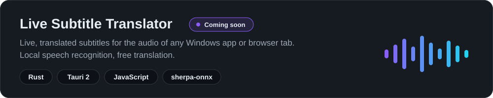
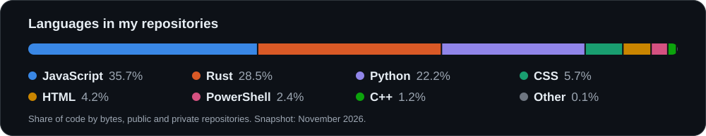

<picture>
  <source media="(prefers-color-scheme: dark)" srcset="assets/header-dark.svg" />
  <source media="(prefers-color-scheme: light)" srcset="assets/header-light.svg" />
  
</picture>

## 👋 About Me

I'm a **Computer Engineering student** who learns by building. I'm interested in software development and in turning problems into practical solutions.

- 🎓 Studying **Computer Engineering**
- 🌱 Learning through coursework and hands-on side projects
- 🔭 Currently building **Live Subtitle Translator**
- 📫 Always open to learning new tools, frameworks and best practices
- ⚡ Fun fact: most of my code works, the rest is a learning experience 🙂

## 🚀 Featured Project

<picture>
  <source media="(prefers-color-scheme: dark)" srcset="assets/project-dark.svg" />
  <source media="(prefers-color-scheme: light)" srcset="assets/project-light.svg" />
  
</picture>

## 🛠️ Tech Stack

**Languages**

<table>
  <tr>
    <td align="center" width="96"> <b>Rust</b></td>
    <td align="center" width="96"> <b>JavaScript</b></td>
    <td align="center" width="96"> <b>Python</b></td>
    <td align="center" width="96"> <b>Java</b></td>
    <td align="center" width="96"> <b>C++</b></td>
    <td align="center" width="96"> <b>HTML</b></td>
    <td align="center" width="96"> <b>CSS</b></td>
  </tr>
</table>

**Frameworks & Tools**

<table>
  <tr>
    <td align="center" width="96"> <b>Tauri</b></td>
    <td align="center" width="96"> <b>Git</b></td>
  </tr>
</table>

## 📊 GitHub Analytics

<picture>
  <source media="(prefers-color-scheme: dark)" srcset="assets/languages-dark.svg" />
  <source media="(prefers-color-scheme: light)" srcset="assets/languages-light.svg" />
  
</picture>

  <picture>
    <source media="(prefers-color-scheme: dark)" srcset="https://streak-stats.demolab.com/?user=berattmenekse&disable_animations=true&border_radius=14&background=0D1117&border=30363D&stroke=30363D&ring=8B5CF6&fire=22D3EE&currStreakNum=E6EDF3&sideNums=E6EDF3&currStreakLabel=22D3EE&sideLabels=9DA7B3&dates=9DA7B3" />
    <source media="(prefers-color-scheme: light)" srcset="https://streak-stats.demolab.com/?user=berattmenekse&disable_animations=true&border_radius=14&background=FFFFFF&border=D0D7DE&stroke=D0D7DE&ring=7C3AED&fire=0891B2&currStreakNum=1F2328&sideNums=1F2328&currStreakLabel=0E7490&sideLabels=59636E&dates=59636E" />
    
  </picture>

<picture>
  <source media="(prefers-color-scheme: dark)" srcset="https://github-readme-activity-graph.vercel.app/graph?username=berattmenekse&bg_color=0d1117&color=9da7b3&title_color=e6edf3&line=8b5cf6&point=22d3ee&area=true&area_color=8b5cf6&border_color=30363d&radius=14&custom_title=Contributions%20in%20the%20last%2030%20days" />
  <source media="(prefers-color-scheme: light)" srcset="https://github-readme-activity-graph.vercel.app/graph?username=berattmenekse&bg_color=ffffff&color=59636e&title_color=1f2328&line=7c3aed&point=0891b2&area=true&area_color=7c3aed&border_color=d0d7de&radius=14&custom_title=Contributions%20in%20the%20last%2030%20days" />
  
</picture>

## 🐍 Contribution Snake

<picture>
  <source media="(prefers-color-scheme: dark)" srcset="https://raw.githubusercontent.com/berattmenekse/berattmenekse/output/snake-dark.svg" />
  <source media="(prefers-color-scheme: light)" srcset="https://raw.githubusercontent.com/berattmenekse/berattmenekse/output/snake.svg" />
  
</picture>

---

<i>Thanks for stopping by! ⭐</i>

